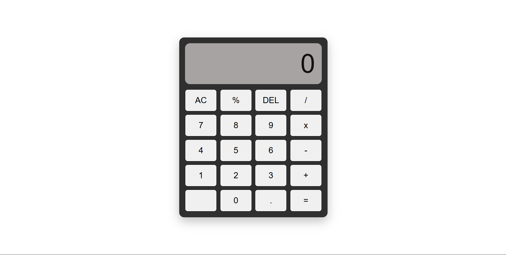

# Web Calculator

A simple and responsive web calculator designed to perform basic mathematical operations through an easy-to-use interface.

## ✨ Features

* Addition
* Subtraction
* Multiplication
* Division
* Clear/reset functionality
* Decimal number support
* Responsive design
* Interactive calculator buttons
* Real-time calculation display

## 🎯 Purpose

This project was created to practice JavaScript fundamentals, DOM manipulation, event handling, and building interactive web interfaces.

## 🛠️ Technologies Used

* HTML5
* CSS3
* JavaScript

## 📸 Preview

## 📄 License

This project was created for educational and portfolio purposes.
